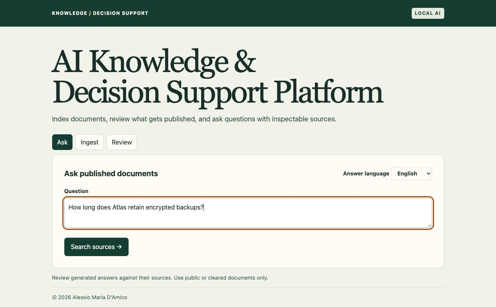
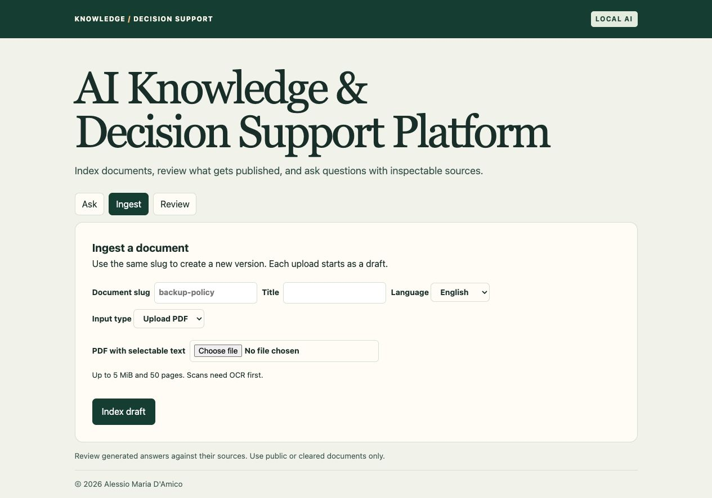
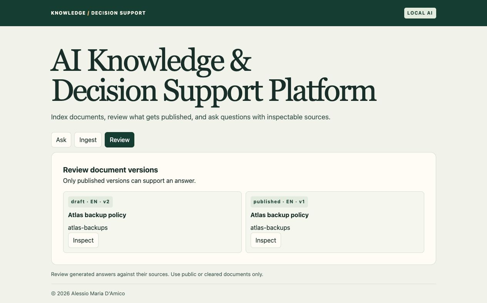

# AI Knowledge & Decision Support Platform

**Independent R&D Project · 2026**

Developed by Alessio Maria D'Amico

A local web application for ingesting text documents, reviewing versions, and asking questions against published material. The app generates answers with Qwen and returns the exact passages behind its citations. The example corpus uses synthetic IT operations documents.

[Architecture and request flow](docs/ARCHITECTURE.md) · [Threat model](docs/THREAT_MODEL.md) · [Evaluation cases](evaluation/cases.json)

## MVP Demonstration

### Ask



### Ingest



### Review



## Run locally

Use Python 3.12 and Node.js 22+. Model weights are downloaded separately; allow several GB of disk and RAM.

```sh
npm ci
npm run build
python3.12 -m venv .venv
source .venv/bin/activate
python -m pip install -r requirements-models.txt
export HF_HOME="$PWD/.hf-cache"
HUB_ALLOW_DOWNLOAD=1 python -m evaluation.run
python -m uvicorn hub.app:app --host 127.0.0.1 --port 8769 --no-access-log
```

The evaluation warms the Hugging Face cache and uses a temporary database. Subsequent runs default to cache-only model loading. Open **http://127.0.0.1:8769**. In **Ingest**, paste text or upload a PDF with selectable text (up to 5 MiB and 50 pages). Use **Review** to inspect its chunks and publish the version. In **Ask**, use **Search sources** to inspect ranked published passages without running Qwen. Select **Generate answer** if you want a draft answer; the search results stay visible if generation fails. API docs are at `/docs`.

With Docker Compose, run `HUB_ALLOW_DOWNLOAD=1 docker compose up --build` for the first session and exercise ingestion and search to fill the model cache. The application and models run in one container; named volumes store the documents and model weights. Recreate without `HUB_ALLOW_DOWNLOAD=1` to use cached models only. Do not expose this single-user demo to other users.

## How it works

React → FastAPI → overlapping text chunks → multilingual E5 embeddings → exact cosine search over SQLite vectors → multilingual cross-encoder reranking → Qwen generation with Transformers and PyTorch → validated citation IDs.

The UI accepts pasted plain text and text-based PDFs, tracks document versions by slug, and makes draft review explicit. English, Spanish and French are selectable response languages. A single published corpus is searched across languages. The system abstains when no passage qualifies or the answer lacks valid citation IDs. A citation establishes which passage the model referenced; it does not prove the passage supports every claim.

## Tests and evaluation

```sh
python -m unittest discover -s tests -v
python -m evaluation.run
```

Unit tests use controlled model doubles. The real-model evaluation reports retrieval recall at four, simple answer and citation checks, an abstention case, an injection case, per-request timing and token counts, and peak process memory. These are small smoke checks, not a general accuracy benchmark. GitHub Actions builds the UI, runs unit tests, and checks the Compose configuration. No deployment pipeline is configured.

PDF source cards show the filename and physical page number. The original PDF is not stored. Scanned PDFs need OCR first, and tables or multi-column text may extract out of order. The current scope is local use, small corpora, and manual publication. OCR, authenticated reviewer roles, indexed approximate nearest-neighbor search, claim-level verification and production operations are outside this version.
