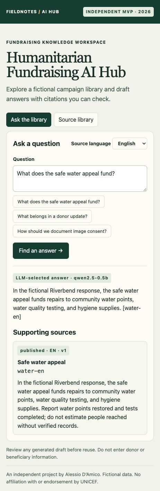

# Humanitarian Fundraising AI Hub

An independent full-stack portfolio MVP by Alessio D’Amico (2026). It helps a fictional fundraising team find source-backed answers for draft campaign and donor communications. It is not UNICEF work, has no affiliation or endorsement, and contains no private UNICEF, donor, or beneficiary data.



## Try it locally

Requires Node.js 22+ and Python 3.9+ (CI uses Python 3.12). From the repository root:

```sh
npm ci
npm run build
python3 -m venv .venv
source .venv/bin/activate
python -m pip install -r requirements.txt
python -m uvicorn hub.app:app --host 127.0.0.1 --port 8769 --no-access-log
```

Open **http://127.0.0.1:8769**. Ask **What does the safe water appeal fund?** and inspect its supporting source. Switch the source language to **Español** and try **¿Qué debe incluir un informe a donantes?**. Ask **Who discovered Neptune?** to see the insufficient-evidence state. Open **Source library** to see the published and draft metadata. Without a model configured, the app explicitly displays attributed excerpts.

### Enable the local LLM

Use a recent [llama.cpp server](https://github.com/ggml-org/llama.cpp) and a compatible instruction model. The demo uses the [Qwen2.5-0.5B-Instruct Q4_K_M GGUF](https://huggingface.co/Qwen/Qwen2.5-0.5B-Instruct-GGUF). Download the model separately and keep it outside the repository. On macOS with Ollama installed, its bundled executable can be used if available at `/Applications/Ollama.app/Contents/Resources/llama-server`.

```sh
llama-server -m /path/to/qwen2.5-0.5b-instruct-q4_k_m.gguf \
  --alias qwen2.5-0.5b --host 127.0.0.1 --port 18081 -c 2048 -ngl 0 -t 4
```

In a second terminal, activate the Python environment and start FastAPI (stop any previous instance first):

```sh
HUB_MODEL=qwen2.5-0.5b python -m uvicorn hub.app:app --host 127.0.0.1 --port 8769 --no-access-log
```

A successful model-assisted answer is labeled **LLM-selected answer**. Both servers bind to loopback, and the application sends no prompts to a cloud API. Interactive REST documentation is available at `/docs`.

## Architecture

```text
React UI → FastAPI /api/ask → language + published filter → weighted keyword retrieval
                                              ↓
                  llama.cpp + local Qwen ← candidate sentences from up to two sources
                                              ↓
                  validated selection → exact source sentence + server-attached citation
```

The model selects one numbered candidate sentence. It generates a constrained index; it does not write free-form campaign copy. The server verifies the index and attaches the citation from its own records. If the model is unavailable or its response is invalid, the app shows visibly labeled source excerpts. If retrieval finds no adequate match, no model request is sent.

The JSON knowledge library holds fictional text and source IDs, topics, locales, versions, and draft/published status. It models a small Git-based editorial workflow: propose an edit as draft, review the copy and locale variants, then mark it published in a reviewed change. Draft text is excluded from retrieval and the library endpoint. This is a read-only CMS demonstration; it has no editing UI, roles, or private storage. The sample draft is visible in the source code.

## Validation

```sh
python -m unittest discover -s tests -v
npm run build
```

On 9 November 2026, the local browser demo returned model-selected answers for the English water appeal and Spanish donor reporting examples, declined an unrelated question, and displayed draft metadata without draft text.

The tests cover locale filtering, draft exclusion, abstention before model invocation, request grounding, invalid model output, and fallback on model outage. GitHub Actions runs the build and automated tests on pushes and pull requests. No deployment workflow is configured.

## Responsible AI and security

- Only use fictional or cleared content. Never enter personal donor or beneficiary information.
- Review answers against the displayed source before reuse. A valid citation proves which text was selected; it does not prove the selection answers the question.
- No tool calling or free-form model output is rendered. A grammar constrains selection and the API checks it independently.
- The application uses bounded question length, supported locale validation, restricted host headers, a fixed local model endpoint, and a model timeout. There is no app database or prompt history. Keep both services on loopback.
- This is a single-user local MVP. It has no authentication, rate limiting, transport security, production monitoring, or formal security review. Do not expose it publicly as-is.

## Limits and roadmap

Retrieval uses language-specific lexical matching with accent normalization and a small set of curated tags. It does not translate, search across languages, retrieve from the live web, or use semantic embeddings. The corpus is deliberately small and does not represent operational guidance. The UI is in English; the source content and answers are available in English and Spanish.

Next: expand and evaluate the bilingual corpus, add semantic retrieval where it improves measured relevance, add authenticated editorial approvals and audit history, and evaluate whether free-form synthesis can preserve attribution and factual accuracy.

## Publish a copy

From the repository root, with the [GitHub CLI](https://cli.github.com/) installed and authenticated:

```sh
gh auth login
gh repo create humanitarian-fundraising-ai-hub --public --source=. --remote=origin --push
```

Alternatively, create an empty public repository on GitHub without a generated README, then follow GitHub’s **push an existing repository** instructions. Publish only this repository directory.
