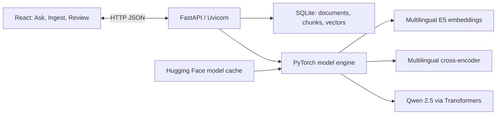

# Architecture

The independent AI Knowledge & Decision Support Platform is a single-user local application. The React UI and FastAPI routes share an origin. A Python worker loads three local model checkpoints on demand; no external inference endpoint is used.



## Ingestion and review

The browser posts a slug, title, locale and plain text (20–24,000 characters). The API splits whitespace-delimited words into 160-word windows with 30-word overlap. Sentence Transformers encodes each chunk with the E5 passage prefix and normalizes the output. SQLite stores document ID, slug, version, title, locale and state separately from ordered chunk text, vector JSON and embedding model ID. The transaction allocates a version and saves its chunks as a draft. The same slug represents one version series, including if a subsequent version changes locale.

Review displays stored chunks and allows the operator to publish or archive. Publishing a draft archives the previously published version for the same slug in the same transaction. Archived versions remain inspectable and cannot be republished directly. This is a state gate for one operator; it is not an identity or authorization boundary.

| Endpoint | Behavior |
|---|---|
| `GET /api/health` | Returns configured model identifiers, device and loaded model names. It does not preload models. |
| `GET /api/sources` | Lists metadata for all versions. |
| `POST /api/documents` | Embeds and saves a new draft version. |
| `GET /api/documents/{id}` | Returns version metadata and ordered chunks for review. |
| `PATCH /api/documents/{id}` | Publishes a draft or archives a version. |
| `POST /api/ask` | Retrieves, reranks and generates a cited answer or abstains. |

## Retrieval and generation

```mermaid
sequenceDiagram
    participant UI as React
    participant API as FastAPI
    participant DB as SQLite
    participant ML as PyTorch models
    UI->>API: Question and requested answer locale
    API->>DB: Published chunks with matching embedding model
    API->>ML: Encode question with E5 query prefix
    API->>API: Exact cosine scan and threshold; retain up to 8
    alt No evidence meets the gate
        API-->>UI: Localized abstention
    else Candidates available
        API->>ML: Cross-encode passages and apply relevance gate
        alt No passage passes reranking
            API-->>UI: Localized abstention
        else Reranked evidence available
            API->>ML: Qwen generates from numbered evidence
            API->>API: Validate citation IDs
            API-->>UI: Answer and cited passages, or abstention
        end
    end
```

Normalized vectors are compared by dot product, with a default threshold of 0.72. Search scans published vectors across locales. The multilingual cross-encoder reorders up to eight candidates; up to four with a reranker score of at least 0 go to Qwen. Both thresholds are configurable and need calibration for larger corpora. Qwen uses its chat template, greedy decoding, PyTorch inference mode and a cap of 220 new tokens. A model exception at the API boundary may result in HTTP 503; the API does not silently switch to a different model or claim to have generated an answer.

The server requires one or more valid request-scoped IDs such as `[S1]` and rejects unknown bracketed references. It joins those IDs to the exact document version and chunk used to build the prompt. The app does not check that every generated claim is entailed by the cited text. The answer locale is a model instruction rather than an enforced output validator.

## Runtime and verification

The front end is bundled by esbuild and served from `dist/` when the build exists at startup. The Dockerfile builds those assets in a Node stage, then serves them from a non-root Python container. Compose publishes the HTTP port to loopback and persists data and the model cache. The in-process model lock serializes inference operations; models remain resident after their first use. CPU is the default. SQLite and a linear vector scan are intentional choices for small local corpora.

Ask responses expose retrieval and total elapsed time, plus generation time, token counts and device when generation runs. The evaluation harness additionally records peak process RSS. CI verifies the frontend build, model-independent tests, and Compose configuration. No hosted service, continuous deployment, or production scaling configuration is included.
